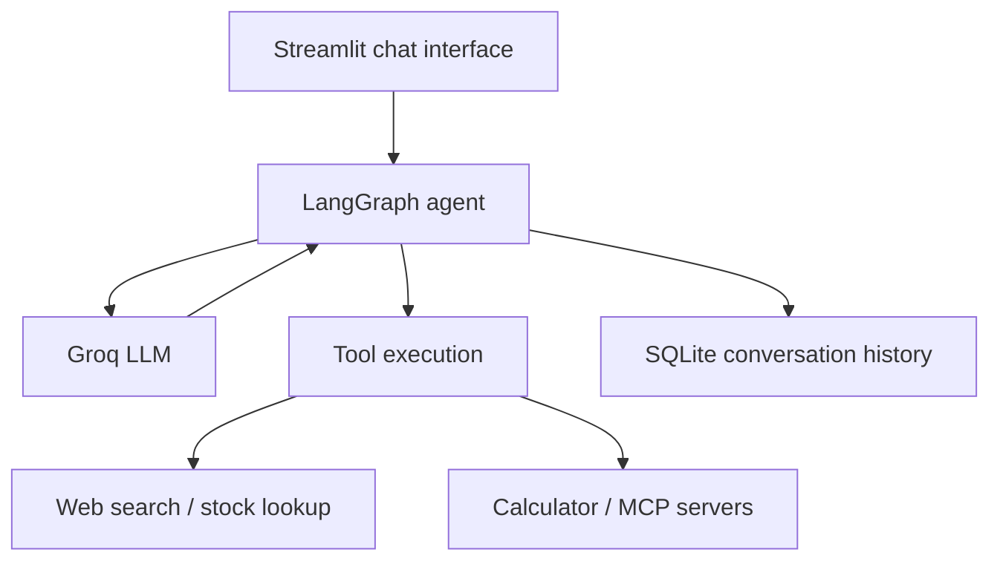

# Multi-Tool Agentic AI Assistant

A Python-based AI chat application that can **reason with an LLM, call external tools, stream responses, and remember conversations**. It combines a Streamlit interface with LangGraph workflows, Groq-hosted models, and optional Model Context Protocol (MCP) servers.

> **Project status:** Development / learning project. Some MCP integrations depend on separate local server scripts that are not included in this repository.

## Features

- **Conversational AI:** Groq-hosted `openai/gpt-oss-20b` model, orchestrated using LangGraph.
- **Tool calling:** The agent can use tools instead of answering from the model alone.
- **Web search:** DuckDuckGo search through LangChain Community.
- **Stock lookup:** An Alpha Vantage-based stock-quote tool.
- **Calculator:** Addition, subtraction, multiplication, and division in the tool-enabled variant.
- **MCP integrations:** Connects to external arithmetic and expense-management tools when their servers are available.
- **Streaming interface:** Displays assistant output as it is generated and shows tool-use status.
- **Conversation history:** SQLite-backed LangGraph checkpoints and conversation selection in the richer interfaces.
- **Multiple implementations:** Basic chat, streaming, SQLite history, built-in tools, and MCP variants for exploring different architectures.

## Tech Stack

| Layer | Technology |
| --- | --- |
| User interface | Streamlit |
| Agent orchestration | LangGraph |
| LLM integration | LangChain + `langchain-groq` |
| Model used in the Python backends | `openai/gpt-oss-20b` via Groq |
| External tools | LangChain tools and MCP (`langchain-mcp-adapters`, FastMCP) |
| Web and financial data | DuckDuckGo Search, Alpha Vantage |
| Persistence | SQLite, LangGraph SQLite checkpointer |
| Runtime | Python |

## How It Works



The agent receives a user message, decides whether a tool is needed, invokes that tool through LangGraph, and returns a response. SQLite-enabled variants save checkpoints so conversations can be resumed.

## Quick Start

### 1. Clone the repository

```bash
git clone https://github.com/jim-jam-jim/Multi-Tool-Agentic-AI-Assistant.git
cd Multi-Tool-Agentic-AI-Assistant
```

### 2. Create a virtual environment

Python 3.11+ is recommended. On **Windows PowerShell**:

```powershell
python -m venv .venv
.\.venv\Scripts\Activate.ps1
```

On **macOS / Linux**:

```bash
python3 -m venv .venv
source .venv/bin/activate
```

### 3. Install dependencies

```bash
python -m pip install --upgrade pip
python -m pip install -r requirements.txt
```

### 4. Set up your API credentials

Create a `.env` file in the project root:

```dotenv
GROQ_API_KEY=your_groq_api_key_here
```

Get your Groq key from the [Groq Console](https://console.groq.com/). **Never commit `.env` or real API keys to GitHub.** The app uses `python-dotenv` to read local environment variables.

### 5. Run the app

Start with the basic chatbot, which does **not** require separate MCP servers:

```bash
streamlit run streamlit_frontend.py
```

For persistent conversations and built-in tools:

```bash
streamlit run streamlit_frontend_database.py
```

For the experimental streaming + MCP interface, first complete the MCP setup below, then run:

```bash
streamlit run claude_streamlit_frontend_mcp.py
```

Streamlit normally opens the app at `http://localhost:8501`.

## MCP Setup (Optional)

The full MCP backend is **not portable without configuration changes**. In particular, `claude_langgraph_mcp_backend.py` currently points to local Windows scripts outside this repository for its arithmetic and expense tools.

1. Open `claude_langgraph_mcp_backend.py` and update the `MultiServerMCPClient` server configuration to match paths on your computer.
2. You can use the repository's `client.py` as a sample FastMCP arithmetic server (it exposes add, subtract, multiply, and divide).
3. The expense MCP server referenced by the backend is a separate project and is **not included here**. Provide that server or remove its entry from the MCP configuration.
4. `langgraph_mcp_backend.py` is another MCP experiment that uses a local arithmetic script plus a configured remote expense endpoint. Its availability depends on those services.

When MCP tools cannot be loaded, the newer Claude-named backend logs a warning and continues with its built-in tools. The Claude-named files still use **Groq** as their LLM provider; their names do not mean they require an Anthropic API key.

## Project Files

| File | Purpose |
| --- | --- |
| `langgraph_backend.py` | Basic LangGraph chatbot with in-memory checkpoints |
| `streamlit_frontend.py` | Minimal chat UI |
| `streamlit_frontend_streaming.py` | Streaming UI variant |
| `langgraph_database_backend.py` | SQLite-backed chatbot |
| `test_chat.py` | Small Streamlit UI for the SQLite chatbot |
| `langgraph_tool_backend.py` | Agent with web search, calculator, and stock lookup |
| `streamlit_frontend_database.py` | Chat history and tool-enabled UI |
| `langgraph_mcp_backend.py` | MCP-enabled backend experiment |
| `streamlit_frontend_mcp.py` | MCP-enabled Streamlit UI |
| `claude_langgraph_mcp_backend.py` | Dedicated async event loop, MCP tools, and SQLite checkpointing |
| `claude_streamlit_frontend_mcp.py` | Streaming UI with tool-status display and saved chats |
| `client.py` | Example FastMCP arithmetic server |
| `basic_chatbot.ipynb` | Notebook experiments with multiple LLM integrations |

Other scripts (`streamlit_frontend_threading.py`, `test.py`, `hello.py`) are experiments and development utilities.

## Notes and Current Limitations

- **Secrets:** An Alpha Vantage API key is currently embedded directly in multiple backend source files. Rotate that key, then update the stock lookup function to load a replacement from an environment variable such as `ALPHAVANTAGE_API_KEY` before further public use.
- **External MCP scripts:** Local absolute Windows paths in the MCP backends need to be made configurable for other machines.
- **Local data:** `chatbot.db`, SQLite write-ahead log files, Python cache files, editor settings, and checkpoint files are runtime artifacts—not project source. They should be excluded from Git tracking. Adding them to `.gitignore` does not remove copies already committed.
- **Dependencies:** `requirements.txt` lists packages inferred from imports. Exact versions should be locked after testing in a clean environment.
- **Tests:** There is not yet a comprehensive automated test suite or a production deployment configuration.

## Ideas for Future Improvements

- Replace hardcoded paths and stock API credentials with environment-driven configuration.
- Add automated tests for graph execution, tool failures, and checkpoint recovery.
- Provide a local expense MCP server and a reproducible example configuration.
- Add error handling, retries, and clear feedback for third-party service failures.
- Add screenshots or a short demo once the UI has been finalized.

## Author

Developed by **Aryan Raj**. Contributions and suggestions are welcome through GitHub issues.
